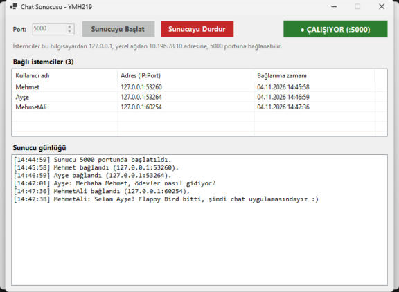
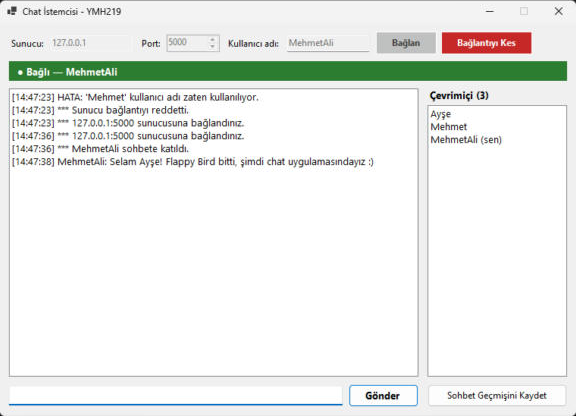
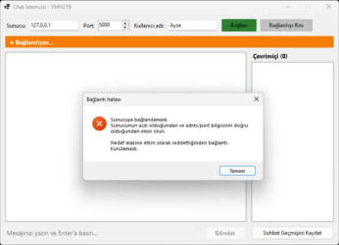

# İstemci-Sunucu Chat Uygulaması — YMH219

TCP/IP üzerinden çalışan, bir **sunucu** ve birden fazla **istemciden** oluşan Windows Forms sohbet uygulaması. İstemciler kullanıcı adıyla sunucuya bağlanır; gönderilen her mesaj sunucu üzerinden bağlı tüm kullanıcılara iletilir (ortak sohbet odası). Aynı bilgisayarda veya aynı yerel ağda çalışır.

Bu proje **Nesne Tabanlı Programlama (YMH 219)** dersi ek uygulama ödevi kapsamında hazırlanmıştır.

**Öğrenci:** Yusuf Aslan — **Numara:** 250541068

## Ekran Görüntüleri

| Sunucu | İstemci |
|---|---|
|  |  |

**Hata yönetimi:** sunucu kapalıyken bağlanmaya çalışıldığında uygulama kapanmaz, kullanıcıya açıklayıcı bir mesaj gösterilir.



## Kullanılan Teknolojiler

- C# / .NET 10, Windows Forms
- `TcpListener` (sunucu) ve `TcpClient` (istemci)
- `NetworkStream` üzerinde `StreamReader` / `StreamWriter` ile satır tabanlı iletişim
- `async` / `await` ile arayüzü dondurmayan ağ işlemleri
- `System.Text.Json` ile mesajların JSON'a çevrilmesi
- Harici NuGet paketi kullanılmamıştır.

## Proje Yapısı

Çözüm üç projeden oluşur:

| Proje | Dosya | Görevi |
|---|---|---|
| **ChatShared** (sınıf kütüphanesi) | `MessageType.cs` | Mesaj türleri: Join, Chat, Leave, System, UserList, Error |
| | `ChatMessage.cs` | Tek bir mesaj (tür, gönderen, metin, zaman, kullanıcı listesi); JSON dönüşümü |
| | `MessageChannel.cs` | Bir TCP bağlantısı üzerinden mesaj gönderme/alma (her mesaj bir satır JSON) |
| **ChatServerApp** | `ChatServer.cs` | İstemcileri kabul eder, katılımı doğrular, mesajları herkese dağıtır |
| | `ClientConnection.cs` | Bağlı bir istemcinin bilgileri (kullanıcı adı, adres, bağlanma zamanı) |
| | `ServerForm.cs` | Sunucu arayüzü: başlat/durdur, bağlı istemci listesi, sunucu günlüğü |
| **ChatClientApp** | `ChatClient.cs` | Sunucuya bağlanır, mesaj gönderir, gelen mesajları dinler |
| | `ClientForm.cs` | İstemci arayüzü: bağlan/gönder/bağlantıyı kes, mesajlar, çevrimiçi liste |

Ağ işlemleri (`ChatServer`, `ChatClient`) arayüzden ayrı sınıflardadır; formlara olaylar (event) ile haber verirler.

## Kurulum ve Çalıştırma

1. Depoyu indirin ve `YMH219-ChatApp.slnx` dosyasını **Visual Studio 2026** ile açın (.NET 10 SDK gerekir).
   ```bash
   git clone https://github.com/JuseufLeo/YMH219-ChatApp.git
   ```
2. **Derle → Çözümü Derle** ile üç projeyi derleyin.
3. Sunucuyu çalıştırın: başlangıç projesi olarak `ChatServerApp` seçip **Hata Ayıkla → Hata Ayıklama Olmadan Başlat**, ardından pencerede **Sunucuyu Başlat** (varsayılan port 5000).
4. İstemcileri çalıştırın: başlangıç projesini `ChatClientApp` yapıp aynı komutla iki veya daha fazla kez başlatın.
5. Her istemcide sunucu adresini (`127.0.0.1` veya sunucu penceresinde yazan yerel ağ IP'si), portu ve bir kullanıcı adı girip **Bağlan**'a basın.

Komut satırından:
```bash
dotnet run --project ChatServerApp
dotnet run --project ChatClientApp
```

> Not: Yerel ağdaki başka bir bilgisayardan bağlanmak için Windows Güvenlik Duvarı'nın sunucuya izin vermesi gerekebilir.

## Özellikler

- Sunucu: port seçimi, başlat/durdur, durum göstergesi, bağlı istemcilerin kullanıcı adı / IP:port / bağlanma zamanı listesi, zaman damgalı sunucu günlüğü
- İstemci: kullanıcı adıyla bağlanma, **Bağlan / Mesaj Gönder / Bağlantıyı Kes**, Enter ile gönderme, durum göstergesi
- Mesajlar gönderen adı ve saatiyle (`[14:47:01] Ayşe: Merhaba`) gösterilir
- Birden fazla istemci aynı odada konuşabilir; katılma/ayrılma bildirimleri ve **çevrimiçi kullanıcı listesi**
- Aynı kullanıcı adıyla ikinci kez bağlanma sunucu tarafından reddedilir
- **Hata yönetimi:** sunucu kapalıysa, bağlantı zaman aşımına uğrarsa veya sunucu kapanırsa uygulama çökmez, kullanıcıya bilgi verilir
- **Sohbet geçmişini .txt dosyasına kaydetme**

## Bilinen Sınırlamalar / Geliştirme Notları

- Özel (birebir) mesajlaşma yoktur; tüm mesajlar ortak odaya gider.
- Mesajlar şifrelenmeden gönderilir; yalnızca yerel ağ ve ders amaçlı kullanım içindir.
- Sunucu geçmişi saklamaz; sonradan bağlanan kullanıcı önceki mesajları görmez.
